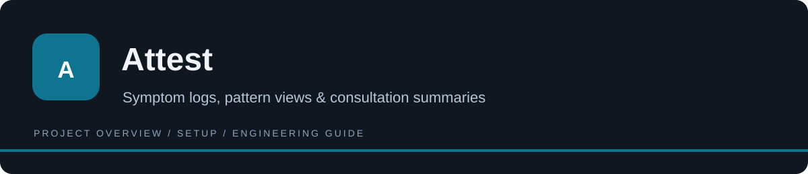

<p align="center"></p>

# Attest

Attest helps a user record symptoms and related daily factors, inspect their history, and prepare report-generation requests. Its React interface separates Today, History, Patterns, and Reports views. A Supabase schema and report Edge Function support connected operation, while the client includes a demonstration fallback. The project should be evaluated as a tracking and reporting application; it does not establish medical diagnosis, regulatory certification, or an insurance decision.

[](https://github.com/ak1458/attest-health-tracker/stargazers)
[](https://github.com/ak1458/attest-health-tracker/watchers)
[](https://github.com/ak1458/attest-health-tracker/forks)
[](https://github.com/ak1458/attest-health-tracker/activity)
[](LICENSE)

**[How it works](#how-it-works) · [Run locally](#run-locally) · [Configuration](#configuration) · [Commands](#development-commands) · [Versions](#versions-and-distribution) · [License](#license)**

## How it works

1. Configure the Supabase project and authentication for connected use, or explore the client demonstration fallback.
2. Record symptom and lifestyle fields through the daily view.
3. Review historical entries and descriptive pattern calculations without treating correlation as diagnosis.
4. Request a generated summary through the deployed server function, then review the output before sharing it.

## Architecture

| Path | Purpose |
| --- | --- |
| [src/components/](<src/components/>) | Authentication, onboarding, daily logging, history, patterns, and reports. |
| [src/lib/store.ts](<src/lib/store.ts>) | Data access and offline write handling. |
| [src/lib/patterns.ts](<src/lib/patterns.ts>) | Descriptive client-side pattern calculations. |
| [supabase/migrations/0001_init.sql](<supabase/migrations/0001_init.sql>) | Schema and row-level policy definitions. |
| [supabase/functions/generate-report/](<supabase/functions/generate-report/>) | Server-side report-generation integration. |

## What is here

- Daily symptom and lifestyle logging with configurable condition fields.
- History and pattern views, plus offline write-queue handling.
- Supabase authentication, schema, and row-level policy definitions.
- A report-generation Edge Function using a server-side model provider.

## Run locally

```bash
git clone https://github.com/ak1458/attest-health-tracker.git
cd attest-health-tracker
npm ci
cp .env.example .env.local
npm run dev
```

Set the Supabase URL and public client key in the environment template. Connected operation requires the [database migration](supabase/migrations/0001_init.sql), authentication settings, and deployed report function. Without configured Supabase, the client includes a demonstration fallback.

The report function expects provider credentials in server-side secrets. See [the function source](supabase/functions/generate-report/index.ts); never place provider keys in `VITE_*` variables.

## Engineering notes

Views live in `src/components/`; data access and patterns live in `src/lib/`; service code lives in `supabase/`. `npm run build` type-checks and bundles the frontend.

The public preview and simulated data are for demonstration. Generated reports need human review. This repository does not establish medical validation, HIPAA certification, or an insurance outcome.


## Configuration

Settings template: [.env.example](<.env.example>). Copy it to the application’s local environment file and fill only the integrations you use.

| Variable | Purpose |
| --- | --- |
| `VITE_SUPABASE_URL` | Supabase project endpoint; use the intended development project. |
| `VITE_SUPABASE_ANON_KEY` | Publishable client key; access still depends on authentication and database policies. |

Environment files and provider tokens must remain untracked. A public client prefix exposes a value in the browser bundle; it is not a safe place for privileged credentials.

## Development commands

Workspace: [package.json](<package.json>). Run these commands from its directory.

| Command | Script defined in manifest |
| --- | --- |
| `npm run dev` | `vite` |
| `npm run build` | `tsc --noEmit && vite build` |
| `npm run preview` | `vite preview` |

These are available commands, not a claim that all checks passed in this documentation pass. Connected checks require the services, credentials, and isolated data described above.

## Operational notes

The public preview can demonstrate interface behavior without proving its connected services. Configure only the Supabase URL/public key in VITE_* variables. The report provider key belongs in server secrets, and provider behavior must be reviewed before sensitive data is used. There is no unit-test script in the root manifest; npm run build performs type checking and bundling, not a complete clinical or data-protection assessment.

## Troubleshooting

| Symptom | What to check |
| --- | --- |
| The app contains demonstration entries | Check whether the Supabase configuration is present and which data path is active. |
| A report request fails | Verify that the function is deployed and its provider secret/model setting is configured server-side. |
| Stored data is not visible for another account | Check ownership and row-level access rather than weakening the policy to make a demo work. |

## Versions and distribution

Manifest versions are application/workspace metadata, not a certification of release readiness.

| Manifest | Declared version |
| --- | --- |
| [package.json](<package.json>) | `0.1.0` |

No published GitHub Release or version tag was recorded in this snapshot. The default branch is a development/source snapshot; it must not be described as a stable downloadable release merely to populate the sidebar.

GitHub Packages is a separate registry. This README does not imply that a registry package exists; use the installation path documented here rather than an invented package-install command.

## Documentation and maintenance

- [SECURITY.md](<SECURITY.md>)
- [CONTRIBUTING.md](<CONTRIBUTING.md>)
- [supabase/migrations/0001_init.sql](<supabase/migrations/0001_init.sql>)

For change proposals, see [CONTRIBUTING.md](CONTRIBUTING.md). Include the affected workflow, reproduction steps, and relevant check output when reporting a problem. Do not include credentials or live customer data.

## License

This repository’s project code is **proprietary / all rights reserved**. Public visibility does not grant unrestricted reuse. Read [LICENSE](<LICENSE>) for the exact terms. Third-party dependencies and bundled components retain their own notices.
